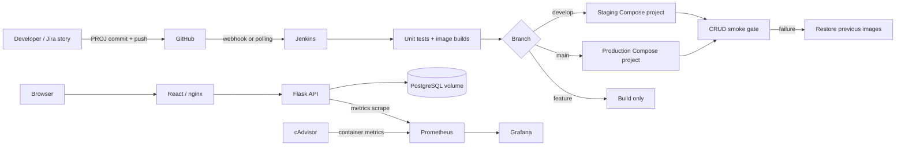

# Helpdesk — Full-stack Support Portal with CI/CD

An academic seven-experiment project: Flask support-ticket API, React/nginx, PostgreSQL, Jenkins, Prometheus, Grafana and cAdvisor, configured for a local Docker engine. The website also has a separate SQLite preview.

**One-line project description:** Building an end-to-end CI/CD pipeline for a full-stack support ticket portal using Docker, Jenkins, GitHub, Prometheus, and Grafana, with automated testing, deployment, rollback, and monitoring.



## What the website does

- **Accounts:** register as a requester, sign in/out, and access role-scoped data. Staff accounts are provisioned by an administrator.
- **Overview:** active/unassigned/overdue counts, seven-day ticket activity, priority distribution, and recent activity from the database.
- **Tickets:** create, search, filter by status/priority, edit descriptions, assign agents, track target dates, comment, resolve/reopen and delete with permission checks.
- **Team and reports:** agent directory with workload counts; administrators can add agents; reports summarize the current queue.
- **Responsive interface:** sidebar navigation, mobile drawer, accessible forms/dialogs and loading/error/empty states.

### Local website preview (no Docker)

```bash
python -m pip install -r backend/requirements-dev.txt
cd frontend
npm ci
npm run build -- --configLoader native
cd ..
python backend/preview.py
```

Open http://localhost:8081 and choose **Explore the sample workspace**. It contains fictional users and tickets, labelled as sample data. Edits persist in the ignored `.preview/support.db`. This is the same React/Flask application using SQLite and a local-only demo sign-in. The production factory never enables demo sign-in. The preview does not run Docker, Jenkins, PostgreSQL, Prometheus or Grafana. Stop the preview terminal with Ctrl+C before starting staging on port 8081.

### First administrator in Docker

After starting the Docker stack, run:

```bash
docker compose -p todo-production --env-file .env.production exec backend python manage.py
```

Enter a name/email and a new password at the prompts. The password is hashed and is not passed on the command line. Sign in through the website and add agents on the Team page. Public registration creates requester accounts only. Staging uses the same command with `todo-staging` and `.env.staging`.

Existing Compose project/image/volume names retain the `todo-` prefix to preserve earlier data and rollback state. New support_* tables are additive; old To-Do rows are retained but are not displayed by the support portal. Update both Jenkins secret-file credentials with the new SECRET_KEY value before deploying this version. Keep that key unchanged across releases to preserve sessions.

## Start from a fresh clone

For a fresh Jenkins installation connected to your GitHub repository, use the [automated first-run setup](docs/automated-setup.md). It prepares credentials and the multibranch job, with periodic GitHub scans. Docker runtime validation passed through Jenkins; see [verified evidence](docs/verification.md).

**Windows demo shortcut:** from this project folder, run `powershell -NoProfile -File .\scripts\demo.ps1`. It locates Docker Desktop, generates private env files, builds staging, waits for health checks and verifies CRUD through nginx. Add `-Monitoring -Jenkins` for the full stack. The script leaves containers running so you can present them. Stop with the same flags plus `-Stop`. The current Docker deployment was verified through Jenkins; the launcher is an alternative startup path.

Prerequisites: Git, Python 3.11+ for env generation/tests, Docker Engine/Desktop with Linux containers and Compose v2 supporting `up --wait`; Git Bash/WSL/Linux for shell scripts. Linux/WSL or Jenkins is required for deployments using `flock`. Node 22+ is needed only for frontend development outside Docker. Allow several GB of image storage and preferably 8 GB RAM for the full lab.

Run these from this repository root (PowerShell is fine for the first commands):

```bash
python scripts/init-env.py
docker compose -p todo-production --env-file .env.production config --quiet
docker compose -p todo-production --env-file .env.production up -d --build --wait --wait-timeout 180
```

Open http://localhost:8080. In Git Bash/WSL run `bash scripts/smoke-test.sh http://localhost:8080`. Production API health and metrics are at http://localhost:8000/health and http://localhost:8000/metrics. API: `/api/session`, `/api/auth/*`, `/api/tickets`, `/api/tickets/<id>/comments`, `/api/team`, and `/api/dashboard`. Mutations require the session cookie and `X-CSRF-Token` from `/api/session`.

The init script generates different random passwords and session keys per environment. For older files it adds only a missing SECRET_KEY; existing credentials are preserved. Read your private env file to obtain Grafana's password; never paste it into Git. Credentials must be URL-safe (the generator uses hex). `.env.example` intentionally has empty passwords and cannot start services without values.

```bash
# Same Compose definition, separate staging ports/network/database volume.
docker compose -p todo-staging --env-file .env.staging config --quiet
docker compose -p todo-staging --env-file .env.staging up -d --build --wait --wait-timeout 180
bash scripts/smoke-test.sh http://localhost:8081
# Add monitoring to staging for the demo; preserve already-deployed app images.
docker compose -p todo-staging --env-file .env.staging -f docker-compose.yml -f docker-compose.monitoring.yml config --quiet
docker compose -p todo-staging --env-file .env.staging -f docker-compose.yml -f docker-compose.monitoring.yml up -d --build --no-recreate
# Start Jenkins, then complete the manual setup guide.
docker compose -p todo-ci --env-file .env.production -f jenkins/docker-compose.yml config --quiet
docker compose -p todo-ci --env-file .env.production -f jenkins/docker-compose.yml up -d --build --wait --wait-timeout 240
```

Monitoring: Grafana http://localhost:3000, Prometheus http://localhost:9090, cAdvisor http://localhost:8082. Jenkins: http://localhost:8088. The portal uses hashed passwords, signed cookie sessions, CSRF checks and requester/agent/admin roles; published ports bind to loopback. It remains an academic local deployment, without email delivery, password-reset flows or distributed login throttling. Monitoring cAdvisor requires privileged access to Linux host metrics; Docker Desktop support can vary.

## Verify and develop

```bash
python -m venv .venv
# Linux/WSL: source .venv/bin/activate
# PowerShell: .venv\Scripts\Activate.ps1
python -m pip install -r backend/requirements-dev.txt
cd backend
python -m pytest tests -q --junitxml=../reports/unit-tests.xml
cd ../frontend
npm ci
npm run build
cd ..
# Optional when ShellCheck is installed:
shellcheck -x scripts/common.sh scripts/deploy.sh scripts/rollback.sh scripts/smoke-test.sh scripts/load-test.sh
# Validate Prometheus syntax inside its image after Compose is available:
docker compose -p todo-staging --env-file .env.staging -f docker-compose.yml -f docker-compose.monitoring.yml run --rm --no-deps --entrypoint promtool prometheus check config /etc/prometheus/prometheus.yml
```

Unit tests use temporary SQLite databases for fast isolation. PostgreSQL driver, networking and container runtime behavior require the Compose smoke test. One Gunicorn worker with four threads keeps in-process request metrics accurate; scaling to multiple workers requires the Prometheus client's multiprocess setup.

For API-only development also set SECRET_KEY to at least 32 random characters. Set DATABASE_URL to a local SQLite URL (for example `sqlite:///dev.db`), then from backend run `python -m flask --app 'app:create_app()' run --port 8000`. From frontend run `npm run dev`. Vite proxies `/api` to port 8000. Do not use Flask's development server as the production entrypoint.

## Deployment and recovery

The Jenkinsfile builds immutable tags from commit SHA and build number. Only main/develop receive deployment credentials. `deploy.sh` snapshots actual running image IDs, deploys, and performs smoke checks under a lock. `rollback.sh` restores the application images; it never removes the DB volume. The named Smoke test stage displays the report from the atomic deployment gate, so there is no unlocked gap between deployment and verification.

Manual deployment example (Linux/WSL, with Docker and flock available):

```bash
docker build -t todo-staging-backend:manual-1 backend
docker build -t todo-staging-frontend:manual-1 frontend
bash scripts/deploy.sh staging .env.staging manual-1
# If a previous successful version exists:
bash scripts/rollback.sh staging .env.staging
```

Use unique tags. Rollback assumes compatible database schemas. The Jenkins container's Docker socket grants host control; restrict this lab to trusted repository contributors. Plugins resolve compatible dependencies during image build; freeze the resolved list after successful bootstrap if you need a fully reproducible plugin graph.

## Stop only this project's resources

```bash
docker compose -p todo-staging --env-file .env.staging -f docker-compose.yml -f docker-compose.monitoring.yml down
docker compose -p todo-production --env-file .env.production down
docker compose -p todo-ci --env-file .env.production -f jenkins/docker-compose.yml down
```

Named volumes persist. Do not add `-v` if you want to retain tasks, dashboards or Jenkins configuration.

## Reading order and manual work

Start with the [portal walkthrough and role permissions](docs/portal-guide.md) to explore the website itself.

1. [GitHub, Jenkins, token, webhook and ngrok checklist](docs/github-jenkins-setup.md).
2. [Five-minute demo and rollback scenario](docs/demo-script.md).
3. [Monitoring queries and alert demonstration](docs/monitoring.md).
4. [Jira setup, sprints, stories and screenshot checklist](docs/jira-plan.md).
5. [Experiment mapping](docs/experiment-mapping.md), [viva questions](docs/viva-questions.md), [troubleshooting](docs/troubleshooting.md), and [verification record](docs/verification.md).

## Screenshots checklist (capture these yourself)

1. Git branch graph, PR review, conflict resolution and release tag.
2. Docker images and healthy Compose services for both environments.
3. Jenkins stages, unit test report and the exact triggering commit.
4. GitHub push webhook delivery with successful HTTP response.
5. Browser with the deployed heading and persisted ticket and conversation.
6. Failed candidate build, successful rollback log and restored image IDs.
7. Prometheus targets, Grafana's five panels and firing BackendDown alert.
8. Jira backlog, active board, story criteria and real burndown over time.

## Ten-slide presentation outline

1. Problem statement and academic objectives.
2. Architecture and selected stack.
3. Git workflow and Agile planning.
4. API, frontend and unit tests.
5. Docker images, non-root users and health checks.
6. Compose staging/production isolation and persistence.
7. Jenkins stages, credentials and GitHub webhook.
8. Smoke gate, failure injection and automatic rollback.
9. Prometheus, cAdvisor, Grafana and the alert demo.
10. Results, evidence, runtime limitations and future improvements.

## Git workflow (Experiment 1)

`main` is production, `develop` is staging, and `feature/PROJ-<n>-<short-name>` holds one story. Commit messages use `PROJ-<n>: <message>`.

```bash
git switch -c develop
git switch -c feature/PROJ-2-todo-api
git add backend
git commit -m "PROJ-2: Add support ticket API"
git push -u origin feature/PROJ-2-todo-api
# Open a pull request into develop; review tests and obtain a teammate review.
git switch develop
git pull --ff-only
# With local-only practice branches, merge explicitly:
git merge --no-ff feature/PROJ-2-todo-api
# Promote using a reviewed develop -> main pull request.
git switch main
git pull --ff-only
git tag -a v1.0.0 -m "PROJ-9: First demonstrated release"
git push origin v1.0.0
```

Conflict exercise: from develop create two practice branches. On both, change the same README sentence and commit. Merge the first into a disposable practice integration branch, then merge the second. Read the conflict markers, edit to the intended combined sentence, `git add README.md`, and `git commit -m "PROJ-1: Resolve practice conflict"`. Use `git merge --abort` to abandon the exercise. Do not perform the exercise on main.
